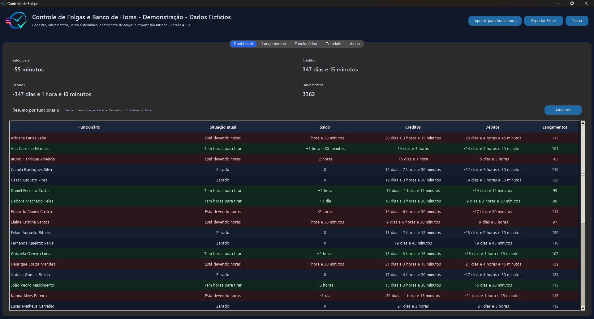
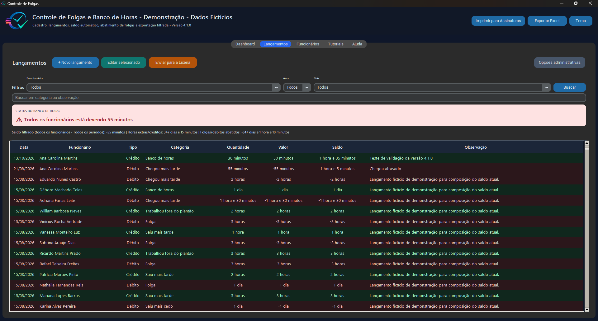
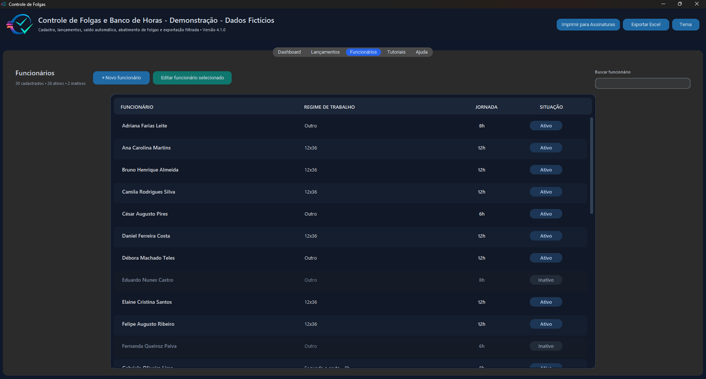

# Controle de Folgas e Banco de Horas

**Sistema desktop de gestão de funcionários, folgas e banco de horas, desenvolvido em Python para Windows.**

O projeto reúne cadastro de funcionários, lançamento de créditos e débitos, cálculo de saldos por jornada, auditoria administrativa e relatórios. Foi criado para atender uma necessidade prática de organização de horas em serviços e equipes, com foco em usabilidade, rastreabilidade e proteção dos dados locais.

**Versão estável:** `4.1.0` · **Interface:** português (Brasil) · **Plataforma principal:** Windows

[Baixar executável oficial (GitHub Releases)](https://github.com/thiagolmoro/controle-de-folgas-releases/releases/tag/v4.1.0) · [Histórico de versões](docs/CHANGELOG.md) · [Guia para desenvolvedores](docs/GUIA_WINDOWS.md)

## Demonstração visual

Capturas feitas com **dados fictícios**; nomes e saldos não representam funcionários reais.

### Dashboard de saldos



### Lançamentos e filtros



### Gestão de funcionários



## Principais funcionalidades

- **Funcionários e jornadas:** cadastro, edição, busca, situação ativa/inativa e jornadas individualizadas (6h, 8h ou 12h).
- **Banco de horas:** créditos, débitos, categorias e saldos calculados em minutos, com visualização por funcionário e período.
- **Interface desktop:** CustomTkinter, tema claro/escuro, abertura maximizada e splash de inicialização.
- **Relatórios:** exportação Excel com histórico, resumos e folhas de assinatura configuradas para impressão.
- **Administração:** senha local, código de recuperação, auditoria e Lixeira com restauração.
- **Segurança de suporte:** autorização offline por assinatura digital Ed25519 para operações administrativas sensíveis, sem senha mestra universal distribuída.
- **Proteção dos dados:** SQLite local, backups consistentes e atualização automática pelo GitHub Releases.

## Tecnologias utilizadas

| Camada | Ferramentas |
| --- | --- |
| Linguagem e interface | Python 3, Tkinter, CustomTkinter |
| Persistência | SQLite |
| Relatórios | openpyxl |
| Imagens | Pillow |
| Assinaturas de suporte | cryptography (Ed25519) |
| Windows | pywin32 |
| Distribuição e testes | PyInstaller, pytest |

## Executar o código no Windows

**Pré-requisitos:** Python 3.14 instalado e Visual Studio Code ou PowerShell.

```powershell
py -3.14 -m venv .venv
.\.venv\Scripts\python.exe -m pip install --upgrade pip
.\.venv\Scripts\python.exe -m pip install -r requirements.txt
.\.venv\Scripts\python.exe .\controle_folgas_v4_1_0.py
```

Na primeira execução, o programa cria `controle_folgas.db` **localmente**, se o banco ainda não existir. Ele inicia vazio, pronto para novos cadastros. **O código publicado não inclui registros de funcionários nem dados reais ou fictícios em banco.**

Para executar os testes automatizados:

```powershell
.\.venv\Scripts\python.exe -m pip install pytest
.\.venv\Scripts\python.exe -m pytest -q
```

Há **14 testes automatizados** que verificam, entre outros aspectos, autorização assinada, backups, compatibilidade de esquema com dados sintéticos e proteção contra callbacks após fechar a janela. Interface, impressão e instalador foram verificados manualmente no Windows, em cenário de demonstração. A suíte automatizada não substitui os testes de interface.

## Estrutura do projeto

```text
controle_folgas_v4_1_0.py        # Aplicação e interface principal
support_security.py              # Validação de autorizações assinadas
support_public_key.py            # Chave pública de verificação (não é secreta)
database_backup.py               # Cópia consistente de bancos SQLite
ferramentas/suporte_cli.py       # Ferramenta offline usada pelo suporte
criar_splash_controle_folgas.py  # Geração de imagem do splash
Controle_de_Folgas_v4_1_0.spec   # Compilação Windows/PyInstaller
Logo/                            # Ícones e imagens da interface
tests/                           # Testes automatizados
docs/                            # Guias, histórico e imagens
requirements.txt                 # Dependências
```

O código foi evoluindo ao longo das versões; a interface e parte das regras de negócio ainda estão concentradas no arquivo principal. Os módulos de segurança e backup já estão separados. A divisão adicional do aplicativo pode ser realizada gradualmente em futuras versões.

## Compilar e atualizar

A compilação do `.exe` usa o arquivo `.spec`, com splash e ícone. Consulte o [guia Windows](docs/GUIA_WINDOWS.md) para os comandos e cuidados de distribuição.

A atualização automática consulta o repositório separado **[controle-de-folgas-releases](https://github.com/thiagolmoro/controle-de-folgas-releases)**. O mecanismo substitui o executável e foi testado na atualização da versão 4.0.2 para 4.1.0 com uma instalação demonstrativa, mantendo o banco SQLite.

## Segurança, privacidade e limitações

O repositório **não contém** bancos `.db`, backups, códigos de recuperação, arquivos de configuração locais ou chaves privadas. A chave pública incluída serve exclusivamente à verificação das autorizações e é intencionalmente pública. A chave **privada** usada pelo suporte deve permanecer protegida e fora do repositório.

A segurança administrativa oferecida pelo aplicativo não substitui as permissões do Windows, criptografia de disco ou controles de acesso ao arquivo SQLite. Veja [SEGURANCA.md](docs/SEGURANCA.md).

## Autoria e uso

Desenvolvimento e manutenção: **[Thiago Luiz Moro](https://github.com/thiagolmoro)**, com auxílio de ferramentas de IA na implementação e revisão.

O código é disponibilizado para apresentação técnica e avaliação do portfólio. **Nenhuma licença de redistribuição/reutilização foi adicionada a este repositório até definição expressa do autor.** Para uso ou colaboração, entre em contato pelo perfil do GitHub.
